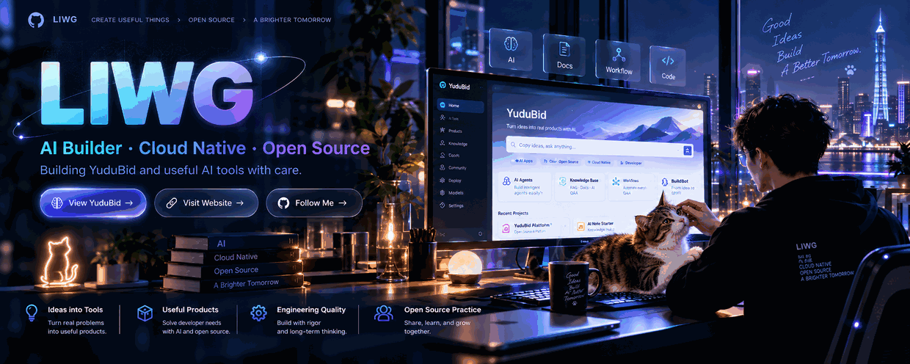
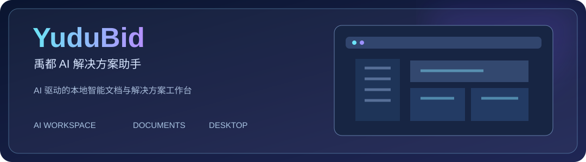

<!-- LIWG · Night Glass Studio | Profile assets are hosted in this repository -->

<a href="https://github.com/liwg1995/YuduBid" title="Discover YuduBid">
  <picture>
    <source media="(prefers-reduced-motion: reduce)" srcset="./assets/hero-still.webp" />
    
  </picture>
</a>

&nbsp;
&nbsp;

Think deeply. Build simply. Share openly.

### Hi, I'm LIWG 👋

**热爱技术，也热爱把想法变成真正有人使用的产品。**

我关注 **AI 应用、Agent、云原生与开源软件**，喜欢从实际问题出发，将复杂的业务流程变成更简单、更高效的工具。比起堆砌功能，我更在意产品是否好用、稳定，以及能否持续创造价值。

目前持续打磨 **[YuduBid · 禹都 AI 解决方案助手](https://github.com/liwg1995/YuduBid)**，探索 AI 在专业文档、解决方案与真实工作流中的落地方式。

AI Applications & Agent Engineering · Cloud Native · Desktop Software · Open Source

### [YuduBid · 禹都 AI 解决方案助手](https://github.com/liwg1995/YuduBid)

**让专业文档创作更智能，让复杂工作流程更简单。**

YuduBid 是一款面向实际工作场景的 AI 桌面助手，围绕 **售前解决方案、技术标书、项目材料与智能文档处理**，将资料整理、章节规划、内容生成、校审和 Word 导出衔接为更连贯的工作流程。

从真实需求出发，持续打磨功能体验、文档质量与桌面端的使用效率。

**[查看源码 ↗](https://github.com/liwg1995/YuduBid)** · **[产品官网 ↗](https://bid.olei.me/)** · **[下载发布版本 ↗](https://github.com/liwg1995/YuduBid/releases)**

**AI · Agent · Cloud Native · Application Engineering**

探索 AI 与工程实践的结合，让技术服务于真实需求。

<picture>
  <source media="(prefers-color-scheme: dark)" srcset="./assets/snake-dark.svg" />
  
</picture>

**Think deeply · Build simply · Share openly**

Keep building things that matter. · LIWG · <a href="https://github.com/liwg1995">@liwg1995</a>

