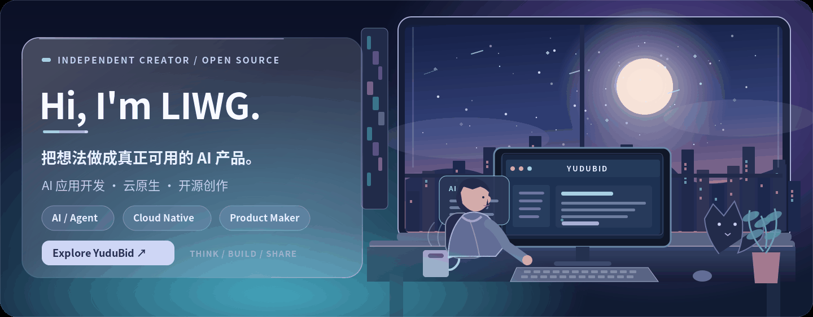
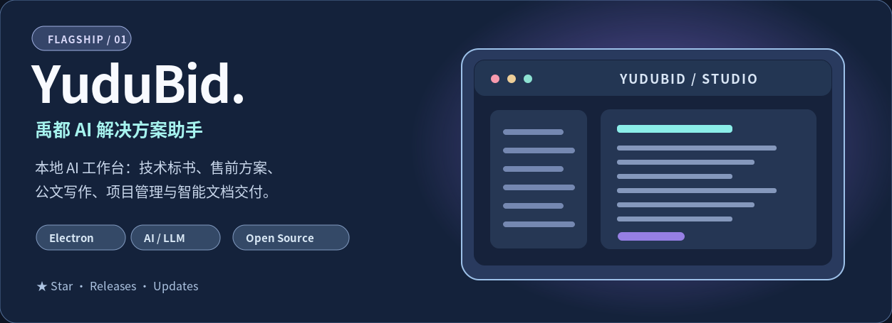
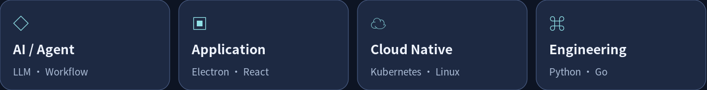

<!--
  LIWG Profile · Night Studio Edition
  Maintains current personal introduction and features only YuduBid.
  Assets local; GIF animation has reduced-motion still.
-->

  <a href="https://github.com/liwg1995/YuduBid" title="查看 YuduBid">
    <picture>
      <source media="(prefers-reduced-motion: reduce)" srcset="./assets/hero-night-studio-still.png" />
      
    </picture>
  </a>

  
  
  

你好，我是 **LIWG**，关注 **AI 应用落地、云原生技术、开源产品与开发者效率**。

我喜欢把复杂的业务需求转化为真正可用的工具，在产品体验和工程实现之间寻找平衡。近期主要投入 **AI 解决方案助手、智能文档工作台和开源应用**，也持续探索 **LLM / Agent 与实际业务工作流的结合**。

- 🤖 **AI / 应用**：AI 辅助文档生成、售前解决方案、智能工作台、开发者工具
- ☁️ **云原生 / 工程**：容器化、Kubernetes、Linux、云边协同与应用工程化
- ✨ **产品理念**：注重体验、长期迭代，尽量让复杂能力变得简单易用

**[YuduBid · 禹都 AI 解决方案助手](https://github.com/liwg1995/YuduBid)**

面向售前支持、技术标书、公文写作、论文辅导、课题申报、项目管理、软著和专利等场景的本地 AI 工作台。把资料整理、内容生成、校审与 Word 导出整合进桌面流程。

> **主要方向**：AI 应用开发 / 桌面客户端 / Web 全栈 / 云原生。上方为日常使用与持续学习的技术领域，不代表每个项目都使用了全部技术。

  
  

<a href="https://github.com/liwg1995">GitHub · @liwg1995</a>　·　<a href="https://bid.olei.me/">YuduBid 官网</a>

Designed for <a href="https://github.com/liwg1995">@liwg1995</a> · Thanks for visiting.
